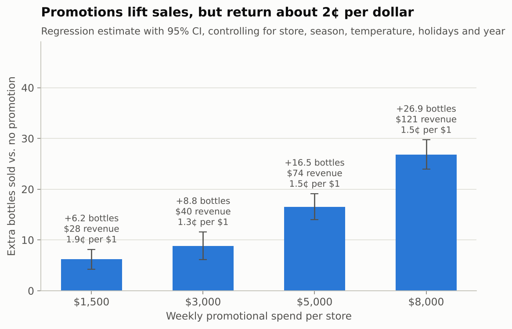
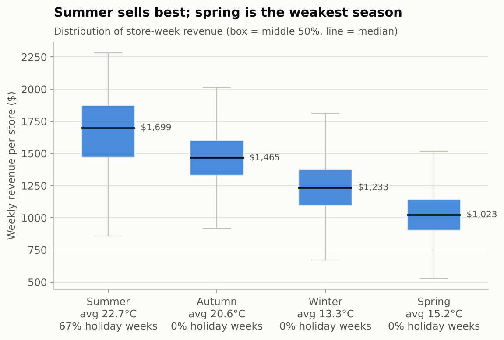
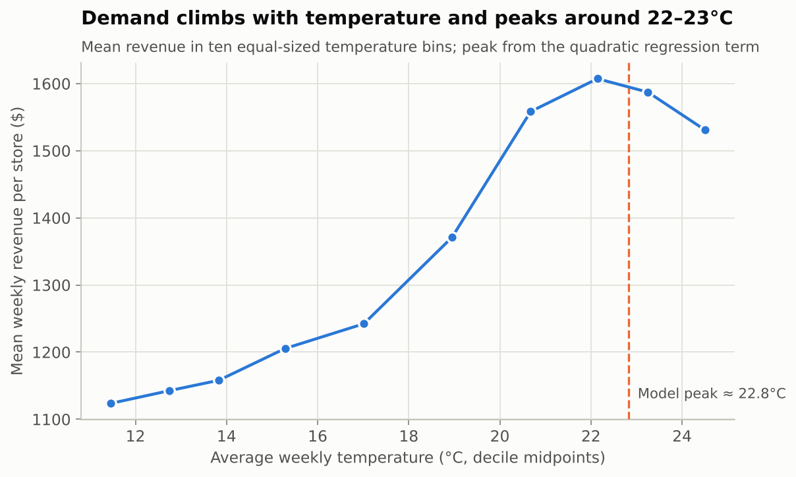
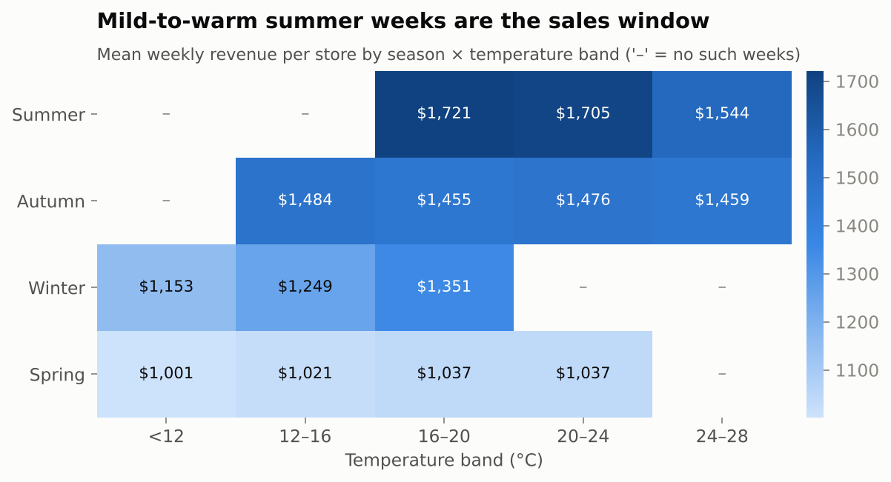
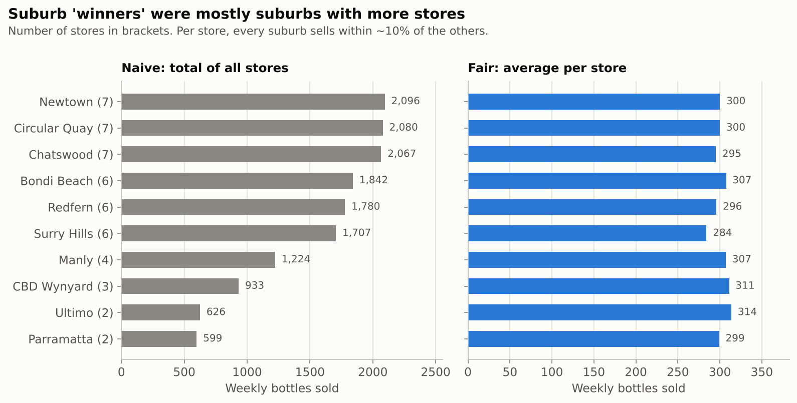

# What Drives Iced-Coffee Sales? — Retail Sales-Driver Analysis

[](https://github.com/YilinW62/coffee-sales-drivers/actions/workflows/ci.yml)


A sales-driver analysis for a chain of **50 bottled iced-coffee stores across 10 Sydney
suburbs**, using **17,600 store-weeks** of data (2019–2025). It asks three management questions:
do promotions pay off, how much do weather and season matter, and are some suburbs really
better than others? The answers come from cleaned data, descriptive analysis and a
**fixed-effects regression with store-clustered standard errors**.

> **Headline:** holiday weeks (+35%) and mild-to-warm weather move sales far more than
> promotions do. Each promotional dollar brings back about **2 cents** of same-week revenue.
> And the apparent "best suburbs" were simply the suburbs with the most stores.

---

## Key findings

### 1 · Promotions work, but don't pay back in the same week


- Raw comparison: promo weeks sell **310 vs 297 bottles (+4.5%)**.
- Holding store, season, temperature, holidays and year constant, the lift grows with budget
  (+6 bottles at $1,500 → +27 at $8,000). That is only **$28–$121 of extra revenue for
  $1,500–$8,000 of spend**, or 1.3–1.9¢ per dollar.
- The lift is similar in every season (13–17 bottles), slightly higher in autumn. Yet the
  largest share of the budget goes to winter ($4.3M of $15.5M).

### 2 · Holidays and temperature are the real demand drivers
|  |  |
|---|---|

- **Holiday weeks add +103 bottles per store (+35% of a normal week)**, the single biggest
  driver. They fall in December–January, which is why summer has both the highest median
  revenue ($1,699/week) and the widest spread.
- Demand follows an **inverted U in temperature**. Revenue rises 43% from ~11°C to ~22°C, the
  fitted model peaks at **22.8°C**, and sales soften in the hottest weeks.
- Spring is the weakest season ($1,023/week). It is cooler than autumn and has no holidays.



### 3 · Suburb "winners" were a store-count illusion


- Adding up all stores in a suburb makes Newtown look **3.5× bigger** than Parramatta. But
  Newtown has 7 stores and Parramatta has 2.
- Per store, every suburb sells **284–314 bottles a week (within ~10%)**. In the regression,
  only Surry Hills is statistically different (−24 bottles/week, 95% CI −42 to −6).
- What does vary is the **individual store**: averages range from 250 to 367 bottles a week.
  Management attention belongs at store level, not suburb level.

## Recommendations

1. **Re-think promotions before scaling them.** At current mechanics they don't recover their
   cost within the week. Run a controlled test of cheaper formats (loyalty points, bundles) and
   measure multi-week and margin effects before committing budget. If promotions continue,
   move budget out of winter, since autumn responds at least as well.
2. **Plan operations around holidays and weather.** Staff up and pre-stock for December–January
   and for forecast 20–24°C weeks. Use spring, the weakest season, for loyalty and
   new-product launches.
3. **Manage stores, not suburbs.** Benchmark the bottom-quartile stores against the top
   quartile (location, hours, staffing) instead of setting suburb-level targets.

## Method

| Step | What was done |
|---|---|
| **Cleaning** | Type parsing (day-first dates, categoricals), missing-value and duplicate checks (none found), 1.5×IQR outlier rule on sales, revenue, temperature and demographics → **17,600 → 17,518 rows (99.5% retained)** |
| **Descriptive analysis** | Promo vs non-promo weeks, season and temperature profiles, season × temperature grid, per-store suburb comparison |
| **Driver model** | OLS on weekly bottles sold with promo budget level, season, temperature + temperature², holiday flag, **store fixed effects** and **year fixed effects** (R² = 0.73, n = 17,518) |
| **Inference** | **Cluster-robust (CR1) standard errors by store**, because weeks from the same store aren't independent; 95% confidence intervals throughout |
| **Return on promotion** | Incremental bottles × average price ÷ budget level = same-week revenue per promotional dollar |

The regression is implemented from scratch in NumPy ([`regression.py`](src/sales_drivers/regression.py)).
It is checked against `numpy.linalg.lstsq` in the tests.

### What this version changed from the first-pass analysis

This started as a course team project. Revisiting it, I corrected three analytical issues:

| First pass | Problem | Fix |
|---|---|---|
| Suburb sales were summed across stores | Suburbs with more stores looked better | Per-store averages and suburb effects in a regression |
| Promo "marginal effect" = row-level Δrevenue ÷ Δspend | Unstable when a week's spend is near the seasonal mean (denominator → 0) | Regression coefficient per budget level |
| Promo vs non-promo raw averages | Mixes in season, weather and store differences | Controls plus store and year fixed effects |

## Run it

```bash
git clone https://github.com/YilinW62/coffee-sales-drivers.git
cd coffee-sales-drivers
pip install -r requirements.txt

python run_analysis.py --data data/sample_sales.csv --out reports   # → reports/results.md + figures
pytest -q                                                            # 8 tests
```

The repo ships a **synthetic** dataset with the same schema (see [`data/README.md`](data/README.md)),
so results will be close to, but not identical to, the figures above. Those were produced
from the original data with the same code. CI runs the tests and the full pipeline on every push.

## Repository layout

```
coffee-sales-drivers/
├── run_analysis.py                  # load → clean → analyse → model → figures → report
├── src/sales_drivers/
│   ├── cleaning.py                  # typing, missing/duplicate checks, IQR outliers + retention log
│   ├── analysis.py                  # the three business questions + driver models
│   ├── regression.py                # OLS with store-clustered standard errors (NumPy)
│   └── plots.py                     # report figures (matplotlib)
├── scripts/generate_sample_data.py  # synthetic, schema-identical dataset
├── data/                            # sample data + schema
├── docs/figures/                    # figures used in this README
├── tests/test_pipeline.py
└── .github/workflows/ci.yml
```

## Limitations

- **Same-week effects only.** Promotions may build longer-term loyalty that weekly data can't see.
- **Revenue, not profit.** No cost or margin data, so return on promotion is a revenue measure.
- **Observational data.** Promotions weren't randomised. Fixed effects remove stable store
  differences, but a controlled test is the right next step before cutting budgets.
- **Temperature and season overlap heavily.** Their separate effects are estimated together, so
  read them as a combined weather/seasonality story.

## About

Originally a five-person university team project, which I led as project leader. This
repository is my refactored version: the analysis is rebuilt as a tested Python package,
the regression analysis is new, and the three issues above are corrected. All store names in
the published data are synthetic.
